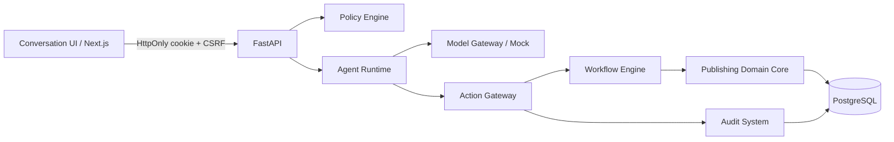

# 架构

本期采用 Next.js/React/TypeScript/Tailwind + FastAPI/SQLAlchemy + PostgreSQL，Docker Compose 启动，Alembic 管理迁移。小型模块化单体使业务事务保持简单，后续证据表明有必要时再拆服务。

| 模块 | 实现 | 接口/职责 |
| --- | --- | --- |
| Publishing Domain Core | apps/api/publishing/models.py | 期刊、用户、期刊成员角色、稿件、编辑任务、会话、审计与邮件快照 |
| Conversation UI | apps/web/app | 浏览器会话恢复、真实工作区、任务输入、详情与审计；运行时同源 API 代理 |
| Agent Runtime | apps/api/publishing/runtime.py | 一次提议、最多一次白名单动作、持久消息与幂等回执；不运行模型代码 |
| Model Gateway | packages/model_gateway | Proposal、Mock、独立 DeepSeek Chat Completions、Ollama/vLLM 可测试适配器、遥测 |
| Workflow Engine | apps/api/publishing/workflow.py | 仅允许 draft → submitted → screening；其他转换明确拒绝 |
| Policy Engine | apps/api/publishing/policy.py, security.py | 登录、CSRF、期刊成员、角色、记录归属 |
| Action Gateway | apps/api/publishing/actions.py, email_gateway.py | 工具参数、事务内创建与分派；邮件快照、逐封审批撤销、禁发 |
| Audit System | apps/api/publishing/audit.py, migrations | 同事务审计，数据库禁止修改、删除、清空审计 |

## 一次命令的事务

认证会话恢复后，先检查编辑权限，再获取 actor+request_id 的 PostgreSQL 事务级 advisory lock。若已存在回执则核对输入 SHA-256 并返回原响应。模型工具必须在白名单中；模型不能传入身份、角色或目标状态。后端查询本期刊合成作者、创建稿件、执行状态转换、创建编辑待办、写对话/审计和回执，在同一次 commit 完成。失败回滚业务写入，拒绝事件单独审计；没有“模型说完成但数据没写入”的成功响应。

同 actor 的相同 request_id 在多进程/并发请求下串行；唯一索引进一步约束回执。不同输入复用 request_id 为 409。事务失败释放锁，可重试原请求。

## 认证和范围

随机 256-bit bearer cookie 仅保存于 HttpOnly/SameSite=Strict cookie；数据库仅存 token hash。会话八小时后过期，可注销撤销；独立随机 CSRF token 随登录或 /auth/me 返回。浏览器同源代理不缓存。密码为随机 salt 的 scrypt；本地演示 HTTP cookie 可通过 COOKIE_SECURE=true 切换 HTTPS 安全标记。

角色存于 Membership，不信任浏览器或模型。首期一个用户一个工作期刊，尚无多期刊选择。编辑可看本期刊，作者须匹配 author_id，审稿人尚无被分派的读取能力。审计只有本期刊编辑/主编可读。API schema 通过 /docs 和 /openapi.json 暴露。

## 外部边界

产品当前固定 Mock，避免环境变量静默向外发送稿件；真实模型仅在独立委派 CLI 明确 --live 后读取新环境密钥。代码草稿写到 UUID 隔离目录，由主 Agent 审查整合，不自动执行。协作探针结果详见 docs/research/deepseek.md。

OJS/Janeway 后续走受控适配器与外部 ID 映射，不共享数据库；接口预留见 packages/integrations/contracts.py，尚未连接外部系统。Mailpit 仅本机捕获服务；邮箱适配器只进行 EHLO/TLS/AUTH 或云账户 GET 身份探测，没有外发 SMTP 传输器。本期不实施生产部署。

## 会话与邮箱边界

`conversations.py` 管理用户+期刊归属的真实 Conversation，Message 必须归属一个会话。工作区 GET 不创建会话；命令可显式指定目标，旧客户端省略目标时在事务内选择/创建默认会话。先查原请求回执再解析默认目标，切换会话后重试仍返回原结果。迁移保留历史消息并回填会话与回执。

`mail_accounts.py` 是受控的邮箱配置动作入口：角色/期刊检查、CSRF、行锁、状态更新与同事务审计。MailAccount 只存配置和安全状态；断开为软禁用，重新绑定复用 ID 并清除旧验证。`packages/mail_adapters` 不读取数据库或环境，由入口注入专用凭据和 SMTP 精确允许列表，只进行只读协议/身份探测。接口不等于 inbox、OAuth 授权流程或发送能力。

服务器凭据引用必须同时匹配 `MAIL_CREDENTIAL_<REF>_JOURNAL_ID`，才读取同命名空间 PASSWORD/ACCESS_TOKEN；前端只提交引用名。Gmail/Graph 固定官方 HTTPS 地址、禁重定向和环境代理、验证证书与身份。SMTP 默认只允许 Mailpit1025，其余目标必须显式允许并使用 TLS。连接状态不能授予发信权限。配置方法见 docs/development/mail-binding.md。

## 下一阶段数据库设计（未实施）

详见 specs/003-editorial-workflow-and-assisted-intake.md。将稿件生命周期、当前步骤实例、负责人工作项、检查证据、内容分类分开建模；版本/作者快照/文件不可变引用支撑可复核的投稿与修回。负责人确认绑定不可变动作提案、输入版本和证据，在同事务内推进状态与生成下一待办。初期采用关系模型+JSONB版本化表单内容，保留当前投影与追加审计，不引入任意可执行workflow DSL或全量event sourcing。

迁移须保留已有ID/消息/幂等回执，旧screening明确为legacy步骤，不能补造查重或人类确认历史。三栏通过后端投影展示同一稿件事实，AI既不生成状态真相，也不拥有最终确认工具。当前代码尚未实现上述实体与API。

## 四页编辑工作台（独立合成数据边界）

`/workbench` 复用真实登录、HttpOnly会话、CSRF和同源代理。`/api/editorial-demo` 仅供编辑/主编读取明确合成的稿件/版本/轮次/候选/问题/附件/历史，数据来源 `packages/editorial_demo/dataset.json` 可整体替换为后续受控真实服务。固定数据跨四页一致，文件与证据由版本/章节/原文片段定位；不冒称解析真实上传文件。

迁移c81b8c41b016只增加 `editorial_demo_states` 与 `editorial_demo_views`：前者按用户+期刊+case唯一，JSONB保存经严格DTO白名单验证的版本笔记、问题核验、候选选择、邀请/决定草稿、AI结果和版本/章节/段落阅读位置；revision配合事务锁返回409。后者保存个人筛选视图。这是支撑本轮交互的最小状态存储，不替代spec003的正式出版数据模型；未执行正式稿件迁移。

所有保存通过受控草稿动作入口写审计；不能修改原型稿件状态、取消评审或发送邮件。AI为可取消/重试的浏览器模拟任务，无供应商调用；保存结果明确为建议，有版本依据与人工处置。读取旧版本保留原版本判断，仅过滤当前显示范围；新增结果必须绑定有效问题与当前版本。真正内容变更需未来新版本机制重新核验，不通过阅读导航删除历史。

代理新增PATCH/PUT方法与Content-Disposition转发，沿用原认证/CSRF/no-store。详细契约specs/004-workbench-contract.md，验证/接入限制见docs/development/workbench-delivery.md。
