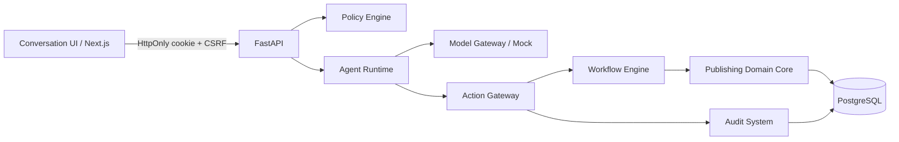

# 架构

本期采用 Next.js/React/TypeScript/Tailwind + FastAPI/SQLAlchemy + PostgreSQL，Docker Compose 启动，Alembic 管理迁移。小型模块化单体使业务事务保持简单，后续证据表明有必要时再拆服务。

| 模块 | 实现 | 接口/职责 |
| --- | --- | --- |
| Publishing Domain Core | apps/api/publishing/models.py | 期刊、用户、期刊成员角色、稿件、编辑任务、会话、审计与邮件快照 |
| Conversation UI | apps/web/app | 浏览器会话恢复、真实工作区、任务输入、详情与审计；运行时同源 API 代理 |
| Agent Runtime | apps/api/publishing/runtime.py | 一次提议、最多一次白名单动作、持久消息与幂等回执；不运行模型代码 |
| Model Gateway | packages/model_gateway | Proposal、Mock、独立 DeepSeek Chat Completions、Ollama/vLLM 可测试适配器、遥测 |
| Workflow Engine | apps/api/publishing/workflow.py | 仅允许 draft → submitted → screening；其他转换明确拒绝 |
| Policy Engine | apps/api/publishing/policy.py, security.py | 登录、CSRF、期刊成员、角色、记录归属 |
| Action Gateway | apps/api/publishing/actions.py, email_gateway.py | 工具参数、事务内创建与分派；邮件快照、逐封审批撤销、禁发 |
| Audit System | apps/api/publishing/audit.py, migrations | 同事务审计，数据库禁止修改、删除、清空审计 |

## 一次命令的事务

认证会话恢复后，先检查编辑权限，再获取 actor+request_id 的 PostgreSQL 事务级 advisory lock。若已存在回执则核对输入 SHA-256 并返回原响应。模型工具必须在白名单中；模型不能传入身份、角色或目标状态。后端查询本期刊合成作者、创建稿件、执行状态转换、创建编辑待办、写对话/审计和回执，在同一次 commit 完成。失败回滚业务写入，拒绝事件单独审计；没有“模型说完成但数据没写入”的成功响应。

同 actor 的相同 request_id 在多进程/并发请求下串行；唯一索引进一步约束回执。不同输入复用 request_id 为 409。事务失败释放锁，可重试原请求。

## 认证和范围

随机 256-bit bearer cookie 仅保存于 HttpOnly/SameSite=Strict cookie；数据库仅存 token hash。会话八小时后过期，可注销撤销；独立随机 CSRF token 随登录或 /auth/me 返回。浏览器同源代理不缓存。密码为随机 salt 的 scrypt；本地演示 HTTP cookie 可通过 COOKIE_SECURE=true 切换 HTTPS 安全标记。

角色存于 Membership，不信任浏览器或模型。首期一个用户一个工作期刊，尚无多期刊选择。编辑可看本期刊，作者须匹配 author_id，审稿人尚无被分派的读取能力。审计只有本期刊编辑/主编可读。API schema 通过 /docs 和 /openapi.json 暴露。

## 外部边界

产品当前固定 Mock，避免环境变量静默向外发送稿件；真实模型仅在独立委派 CLI 明确 --live 后读取新环境密钥。代码草稿写到 UUID 隔离目录，由主 Agent 审查整合，不自动执行。协作探针结果详见 docs/research/deepseek.md。

OJS/Janeway 后续走受控适配器与外部 ID 映射，不共享数据库；接口预留见 packages/integrations/contracts.py，尚未连接外部系统。Mailpit 仅本机捕获服务，应用没有外发 SMTP 传输器。本期不实施生产部署。
