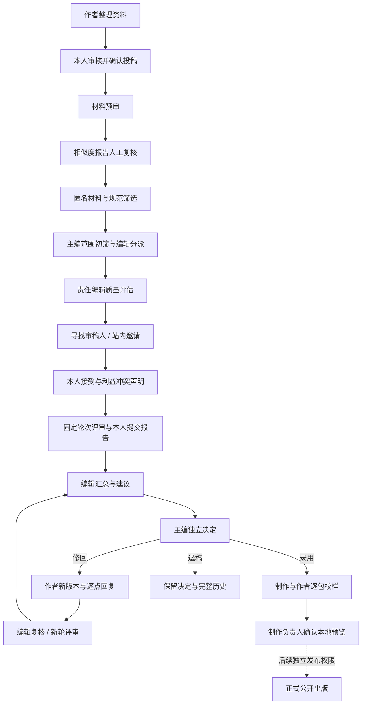

# Publishing OS 核心产品设计

版本：1.0 · 更新：2026-11-03

本文汇总历次产品讨论，作为后续功能设计的统一基线。它描述目标产品；第14节单独列出现有实现，不能把本文件当作新增功能已经上线的证明。`PRODUCT.md`保留当前产品事实，`DESIGN.md`约束视觉，详细业务合同与实际验证分别见`specs/`和`PROGRESS.md`。涉及目标交互冲突时，以本文及用户后续明确修正为准；安全边界继续生效。

## 1. 产品定位

Publishing OS是以对话和AI Agent为核心的科研期刊出版操作系统。作者、编辑、审稿人、主编与出版人员在同一账号体系内，通过自然语言、上下文材料和必要的结构化表单完成出版工作。

系统采用四项原则：

| 原则 | 产品表现 |
| --- | --- |
| Conversation-first | 对话占主体位置，在任务、读稿、填报和审核页面始终可用 |
| Agent-driven | AI主动整理材料、发现缺项、读取证据、调用受控工具并准备下一步 |
| Workflow-backed | 稿件状态、任务、期限和权限由确定性后端与数据库管理 |
| Human-governed | 负责人审核并确认关键操作，所有执行可追溯 |

用户进入系统应立即知道：**我现在需要做什么，这篇稿件在哪一步，谁负责，何时到期，我能让AI帮助完成什么。**

成熟出版系统的业务结构以OJS、Janeway的官方资料和固定版本源码为参考；Publishing OS围绕对话重组交互，不复制传统后台的菜单和长表单入口。

## 2. 一个账号，多种职责

一个人只需一个账号，可以同时是作者、编辑、审稿人、主编或制作人员，也可在不同期刊承担不同职责。例如：在A刊任主编，在B刊任责任编辑，在C刊接受审稿，在A刊提交自己的稿件。

必须区分五件事：

| 概念 | 含义 |
| --- | --- |
| 人与账号 | 登录、联系方式、偏好和经过认证的外部身份 |
| 出版社 | 管理旗下期刊的组织范围 |
| 期刊职责 | 在指定期刊被授予的角色、有效期和授权范围 |
| 稿件分派 | 对特定稿件、步骤或审稿轮次承担的实际任务 |
| 当前操作职责 | 本次查看或执行动作使用的职责及其证据 |

首页默认“我的全部工作”，汇总同一出版社下本人所有合法职责的任务；可按期刊和职责筛选，不需要退出并换另一个账号。

“切换视角”只改变当前上下文，不授予权限。每个任务显示其期刊和本人职责；最终确认页明确“你正以哪个期刊的什么职责，确认哪篇稿件的哪项操作”。

权限必须同时满足账号有效、组织/期刊授权、对象分派或所有权、当前步骤与利益冲突规则。不能简单取多个角色的最大权限并集：

- 作者兼主编不能处理或批准自己的稿件；共同作者历史同样是冲突信号。
- 编辑兼审稿人不会自动获得自己未被分派的稿件材料。
- 默认避免同一人兼任同稿独立审稿与最终决定；例外须另有明确策略和授权记录。
- 署名、姓名、邮箱相同，或手工填写ORCID，都不能自动授予账号访问权。
- 权限撤销后，列表、数量、日历、历史对话、模型记忆、下载与旧请求重放同步重新鉴权。

## 3. 工作台：任务、对话、稿件三栏

```text
┌───────────────────┬─────────────────────────────┬───────────────────────┐
│ 我的全部工作       │ 主对话 / 当前稿件对话         │ 当前稿件               │
│ 期刊与职责筛选     │                             │ 当前步骤、负责人、期限  │
│ 待我确认 / 待处理  │ 对话、证据与实际工具执行结果   │ 材料、版本、报告、表单  │
│ 审稿邀请 / 等待中  │                             │ 下一关口与历史          │
│                   │                             │                       │
│ 左下角：日历入口   │ 始终可见的输入框             │ 独立负责人审核入口      │
│ 账号与设置         │                             │                       │
└───────────────────┴─────────────────────────────┴───────────────────────┘
```

左栏按本人需要行动的优先级组织，不让用户先遍历期刊菜单。中栏是主体，承担目标表达、问答、资料整理和执行反馈。右栏承载当前授权材料及确定性的业务事实；没有选中稿件时，可展示当天任务或当前对话明确引用的对象。

点击待办、邀请、稿件或日历事项时，工作区进入对应稿件和职责，右栏与对话保持一致。未发送输入、未保存表单和阅读位置分别保留，不能把A稿输入误发到B稿。

独立审核页具有专用URL，展示完整内容、差异、材料与影响，同时保留中间对话。它不是独立于AI的传统后台，也不能用聊天中的一句“确认”代替实际核对。

窄屏时保留对话主体与输入框；任务、日历和材料通过抽屉或视图切换访问，不挤成三条不可读的窄列。长稿与长表格在自己的区域滚动。

## 4. 两类对话

### 4.1 主对话

提供类似用户所说ChatGPT/dots的开放对话入口：可以问一般问题，也可以讨论跨稿件、跨期刊的本人工作，不必先绑定一篇稿件。

示例：“今天我最需要处理什么？”“各期刊还有哪些审稿邀请没回复？”“帮我解释双盲评审。”“比较这两篇我有权限处理的稿件进度。”

一般知识问答不强行调用出版工具；涉及实时状态时查询真实数据并提供对象链接。事实、模型建议和执行结果分开呈现；没有检索或访问证据时，不声称已经读取外部资料或稿件。联网和新增外部连接是另行受控能力，不因“可以问任何问题”而自动开放。

主对话可以有持续历史，并支持新建、搜索和恢复。用户无需为每篇稿件复制通用问题。

### 4.2 稿件对话

以稳定稿件ID为核心，贯穿投稿、初筛、审稿、修回、决定和制作。每篇稿件有默认对话入口，可按具体任务形成线程；版本与轮次是上下文，不因为修回而失去历史。

同一稿件下的作者、审稿人、编辑与主编**不共用一份自动公开的聊天记录**。默认对话私有，按照用户、期刊、稿件及职责/可见范围隔离。正式报告、作者反馈和协作信息通过明确业务记录分享，不把私人聊天直接变成期刊档案。

每回合记录当时的稿件、版本、轮次、任务和操作职责。切换到旧版本时明确标识；旧版分析不能直接写入新版。引用应能定位实际文件、版本和原文。

| 行为 | 主对话 | 稿件对话 |
| --- | --- | --- |
| 一般知识问答 | 直接回答，必要时说明来源限制 | 可回答，保留当前稿件上下文 |
| 查询本人待办 | 可汇总多个有权范围 | 默认查询当前稿件 |
| 读取稿件材料 | 用户明确选定对象后逐项鉴权 | 使用当前已授权版本和材料 |
| 准备业务修改 | 必须明确目标、职责及预计影响 | 使用当前对象，但仍重新鉴权 |
| 最终确认 | 引导到对应独立审核页 | 引导到对应独立审核页 |

主对话提到某篇稿件时，提供“进入该稿件”链接；正文引用可进入稿件对话或材料。若请求“把它送审”存在多个可能对象，先明确目标，不能凭最近提到的标题执行。

同一主对话中的多个稿件不混成一份可传播记忆。模型逐对象获得允许内容；职责变化或授权收窄后，旧消息及引用重新过滤，不能通过主对话绕过稿件权限。

## 5. 左下角日历与待办

### 5.1 位置与展现

左下角固定日历区域，位于账号与设置上方。桌面默认显示紧凑月历和今天待办摘要，允许收起为日历按钮与待办数；选中日期可展开当天事项列表。需要更宽视图时打开日历面板，保持对话可用。

首页显示“今天、逾期、即将到期”。日历与左侧待办使用相同任务数据和权限，点击某天可过滤待办，点击某项进入对应稿件、任务、职责和对话。

### 5.2 日历关联哪些期限

“所有稿件的deadline”指本人有权访问的稿件与责任事项的全部相关期限，可跨同一出版社的多个期刊汇总；不开放其他用户或未授权期刊的稿件信息。

| 期限类型 | 关联业务对象 | 默认需要行动的人 |
| --- | --- | --- |
| 投稿资料补充 | 补充任务、稿件版本 | 作者 |
| 材料预审、报告复核、范围初筛 | 当前检查/步骤任务 | 对应编辑或主编 |
| 编辑分派、质量评估 | 分派/评估任务 | 主编或责任编辑 |
| 审稿邀请回复 | 本人邀请的回复期限 | 被邀请审稿人 |
| 评审报告提交 | 已接受邀请/本轮评审任务 | 本人审稿人 |
| 编辑汇总、主编决定 | 建议/决定任务 | 责任编辑或主编 |
| 作者修回 | 修回请求及新版本任务 | 作者 |
| 制作与作者校样 | 校样包及对应责任任务 | 制作人员或作者 |

未接受邀请时，可显示“拟定报告截止日”，但不能把它当成已经承担的审稿任务。邀请回复期限和报告期限必须区分。

### 5.3 事项规则

- 每项显示期刊、稿件编号/题名的授权摘要、事项、本人职责、截止时间和任务状态；不以一排无解释的颜色点代替信息。
- 同篇稿件可有多个并行期限。月历可按稿件折叠，明细保留所有实际责任事项；同一个任务不能因多身份或多处数据来源重复计数。
- 区分逾期、今日到期、即将到期、已完成、已取消和无期限。没有deadline不等于已过期。
- 完成、取消、重分派、邀请撤销与改期后，日历同步反映最新任务；历史变更保留。逾期不会自动接受邀请、提交报告、退稿或录用。
- 个人默认只看“需要我行动”，可切换“等待他人”或有权监督的期刊任务，不能把监督任务误算为本人待办。
- 精确时刻统一存UTC，按用户时区显示；“今天”和逾期判断共用规则。仅日期的期限须明确对应的期刊时区和日终规则，处理夏令时，不能静默当作UTC零点。

### 5.4 唯一事实来源

日历是业务期限的投影，不独立保存一份可随意编辑的稿件截止日。初期从已有任务`due_at`及邀请的`response_due_at`、`report_due_at`汇总，定义明确的来源和去重关系。

调整期限必须修改相应业务对象，由有权负责人确认，记录旧值、新值、理由和影响。AI可以建议改期或准备延期申请，不能自行改变正式deadline。审稿人申请延期时，在负责人确认前保留原deadline。

站内提醒可按明确规则生成，去重并提供已读/稍后提醒；它不改变业务期限。邮件提醒必须另走逐封批准及发送网关。Google/Outlook日历同步、ICS订阅属于后续能力，不默认把匿名稿件信息导出到外部。

## 6. 出版社范围的统一审稿邀请中心

审稿人打开“审稿邀请”，默认看到**本出版社旗下各期刊发给自己的全部可见邀请**，不要求先逐个切换期刊。若未来加入多出版社，组织范围必须明确，不能混入其他组织的邀请。

支持按期刊、回复期限、报告期限和状态筛选，分为待回复、进行中、已完成及历史记录。列表展示期刊、匿名策略允许的稿件题名/摘要、邀请说明、本人回复期限、拟定/正式报告期限和当前状态；排序优先待回复及逾期事项。

待回复邀请只能显示允许的摘要，不因此授予全文或作者身份访问。本人声明无冲突并确认接受后，才能取得该轮固定匿名材料和评审任务。拒绝邀请不是拒稿；邀请失效或撤销不是自动提交评审。

同一稿件可能有重邀和多个轮次，保留每次邀请历史，不能因题名相同自动合并。已提交的评审报告保留本人历史，后续新轮是否可读另验授权。

邀请与账号的绑定须有可信依据：已指定的账号、经验证的收件邮箱认领，或经过认证并明确绑定的ORCID。不能只凭姓名、投稿署名或用户手填邮箱/ORCID匹配。认领链接不是公开检索入口，访问与重放均需校验，不泄漏其他邀请。

跨刊邀请中心是“本人邀请的汇总查询”，不是出版社所有稿件的访问授权。尚未成为某刊编辑成员的受邀者，也应能在验证身份后查看自己的受限邀请摘要；接受后创建明确的审稿分派，不自动授予编辑或主编权限。

## 7. 稿件状态与标签体系

**最重要、最显著的标签永远是当前业务步骤。** 不能让“研究论文、人工加急、AI已分析”等标签掩盖稿件真正的进展。

| 信息层 | 示例 | 作用 |
| --- | --- | --- |
| 生命周期 | 投稿准备、初审、外审、修回、决定、制作、已结束 | 概括所在大阶段 |
| 当前步骤 | 查重报告待复核、待主编分派、寻找审稿人 | 主状态，由后端确定 |
| 当前责任与阻塞 | 等作者补充、等审稿人回复、待负责人确认 | 解释谁需要做什么 |
| 并行进展 | 目标2份报告、1人接受、0份已提交 | 解释实际轮次进度 |
| 时间与优先级 | 今日到期、逾期、人工加急 | 与待办和日历关联 |
| 内容分类 | 文章类型、学科、关键词、栏目/专刊 | 检索与分类，不推进状态 |

右栏首先回答“当前步骤—负责人—deadline—阻塞—下一动作”，再展开材料、版本、报告和历史。主步骤与并行任务分开，不能用某一封邀请的状态替代整篇稿件状态。

默认业务链：



退回补材料、正式修回和重新送审分开记录。新版本不得覆盖旧版本及其检查、报告和决定；小修沿明确人工复核链处理，大修按策略进入新轮。相似度报告不等于抄袭结论，AI建议不等于编辑决定。

## 8. AI辅助信息整理与负责人审核

用户可先把散乱信息交给AI，无需先理解完整出版表单：

1. AI识别标题、摘要、作者/机构、关键词、文件等候选，并保留来源与不确定项。
2. 后端按期刊、文章类型、阶段的版本化规则，列出已找到、缺失、冲突及必须由本人声明的项目。
3. 用户只补缺项或处理冲突；长表单分组保存，允许恢复和比较改动。
4. 人工输入优先，AI不能静默覆盖人工值，也不能代勾原创性、版权、伦理、利益冲突或“本人已阅读”等声明。
5. AI准备不可变提案，链接到独立审核页；负责人核对完整内容、实际文件、差异、期限与预计影响。
6. 本人确认后，后端重验身份、职责、分派、版本、冲突及内容快照，在同一事务推进状态、任务和审计。

用户修改内容、替换文件、改派负责人或并发推进后，旧提案不能继续使用。网络重试不能重复提交。AI对表单的辅助适用于作者投稿、编辑检查、审稿报告、反馈整理及制作资料，而不是仅限作者。

## 9. 注册、登录与账号关联

### 9.1 邮箱注册

目标产品支持邮箱注册与登录，包含邮箱所有权验证、找回密码、修改及绑定其他联系邮箱。仅提供未验证邮箱、尚无其他可信身份认证的账号只获得受限引导能力，不能认领邀请、获得期刊职务或读取稿件。ORCID认证也不能代替对某个收件邮箱的所有权验证。

注册不让用户自行授予编辑/主编权限。作者可以在开放投稿期刊建立自己的投稿；编辑职务来自有权管理者的明确授权，审稿访问来自具体邀请和接受后的分派。

“邮箱登录身份”“用来联系的邮箱”和“期刊绑定的SMTP/Gmail/Outlook发件账号”是不同对象，不能因绑定一个邮箱服务就改变登录或期刊权限。

### 9.2 ORCID注册与登录

目标产品提供“使用ORCID注册或登录”。用户前往ORCID官方授权页面，完成认证后返回Publishing OS；首次创建本地账号，已有账号走显式关联流程。手工填写ORCID仅作为稿件元数据，不等于经过认证的登录身份。[ORCID官方登录指南](https://info.orcid.org/documentation/integration-guide/orcid-oauth-sign-in-guidelines/)

由后端验证授权回调并绑定经过认证的ORCID，不收集ORCID密码。初期只请求身份认证所需的最小权限，不默认申请修改ORCID记录的权限；先在官方Sandbox验证。[官方认证教程](https://info.orcid.org/documentation/api-tutorials/api-tutorial-get-and-authenticated-orcid-id/)

不假设ORCID一定返回邮箱；其邮箱是否可读取受用户可见性和授权限制。缺联系邮箱时再请用户补充并验证，不能猜测地址或把“ORCID已认证”等同于“本站邮箱已验证”。[ORCID官方FAQ](https://info.orcid.org/documentation/integration-and-api-faq/)

同一人以后绑定邮箱与ORCID，应回到同一账号。关联或合并须证明对双方身份的控制，不能仅凭相同姓名或声称相同邮箱自动合并。更换邮箱不改变投稿作者历史快照；解除某登录方式前保留有效的其他登录/恢复方式。

### 9.3 与禁发邮件原则的关系

当前最高优先级规则仍是所有真实外发邮件逐封批准，`EMAIL_SEND_ENABLED=false`。本设计不默认豁免注册验证、找回密码或提醒邮件。

开发验收只用Mailpit；面向真实用户开放邮箱自助注册前，须落实验证/恢复邮件的授权发送方案，或由用户另行明确调整事务性安全邮件策略。在此之前，不宣称真实邮箱自助注册已经可用，不自动发送验证信。ORCID接入也需要新的应用凭据和实际回调验收。

## 10. 邮件系统与重大操作

支持绑定自建邮件系统、Gmail和Outlook。连接验证、收件箱、草稿、批准和发送分别是独立能力；“连接成功”不代表可以发信。

AI可整理邮件或准备草稿，任何真实外发都必须由授权人员逐封批准。批准绑定收件人、完整正文、附件及不可变快照；内容变化原批准失效。发送统一经过Action Gateway，检查权限、幂等与异常状态并留审计。

录用、拒稿、撤稿、公开发表和其他重大动作保留相应负责人权限。自动提醒、日期到期、模型置信度和聊天中的自然语言都不能替代最终确认。模型工具表不包含最终确认或真实发送能力。

## 11. 数据与模块的产品边界

以下是逻辑设计，字段和迁移在对应实现规格中定稿，不要求一次建立全部新表。

| 对象 | 需要保留的核心事实 |
| --- | --- |
| User / UserEmail / ExternalIdentity | 稳定用户ID、多个邮箱及验证状态、认证提供方与唯一外部身份、联系方式与偏好 |
| Publisher / Journal | 出版社与旗下期刊、投稿及匿名政策；稿件仍属于一次向具体期刊的投稿 |
| RoleGrant / Assignment | 多个期刊职责、授权者/有效期/范围；具体稿件/步骤/轮次分派及撤销历史 |
| Manuscript / Workflow / StepRun | 稿件稳定ID、当前步骤和修订、主状态与不可覆盖的步骤历史 |
| Version / AuthorSnapshot / FileObject | 按版固定元数据、作者顺序/机构/ORCID来源与认证状态、实际文件hash和可见用途 |
| WorkItem / 业务期限 | 本人需完成的动作、负责人、来源步骤、期限类型/时区语义、完成或取消状态 |
| ReviewRound / Invitation / Report | 固定匿名材料、本人邀请和回复/报告期限、接受/拒绝/撤销、本人报告及其可见分区 |
| Conversation / Thread / Message | 主对话或稿件范围、所有者、职责边界、当时版本/轮次、引用、工具结果及访问依赖 |
| FormDraft / Proposal / Confirmation | 可编辑草稿、字段来源、完整不可变提案、对应负责人的确认及内容摘要 |
| Decision / Revision / Proof / Preview | 建议与决定分开、安全反馈、新版修回、逐包校样与鉴权预览 |
| Notification / MailDraft / Approval / Audit | 站内提醒去重、邮件快照与逐封批准、真实执行结果和追加审计 |

账号身份、期刊角色和稿件署名必须分开。一个人多角色依靠一对多授权关系，不能复制成多个用户或往单一`role`字符串堆值。每次审计记录真实操作者与本次操作职责，保留当时授权依据。

跨期刊列表和日历是经授权的聚合，不复制稿件或将不同期刊投稿合成一条记录。必要时从现有Membership平滑迁移到RoleGrant，保留原ID/审计/回执，不能因迁移自动扩权。

沿用八个模块：Publishing Domain Core定义业务实体；Conversation UI承载工作区；Agent Runtime编排受控任务；Model Gateway管理模型；Workflow Engine决定步骤；Policy Engine判定角色/对象访问；Action Gateway执行修改与确认边界；Audit System保留证据。日历和邀请中心复用同一工作流与策略，不另造权限系统。

## 12. 关键使用场景

### 同一个人承担三种职责

用户登录后看到A刊的主编决定任务、B刊的编辑检查和C刊的审稿邀请。日历在同一视图显示期限，主对话可回答“今天我该先处理什么”。打开某项时进入具体期刊、稿件和职责；不能把A刊主编权限带到C刊审稿。

### 审稿人处理跨期刊邀请

用户在邀请中心比较A/B/C刊发给自己的邀请与时间安排，分别选择接受、拒绝或申请延期。系统只在本人确认并满足无冲突要求后授予对应轮次材料；日历由邀请回复事项切换或关联到实际报告任务。AI可以解释材料和整理意见，但本人审核、选择建议并提交报告。

### 作者先把资料交给AI

作者从主对话说“我想向A刊投稿”，在明确期刊后建立私人稿件并进入稿件对话。散乱文字和文件经AI整理，右栏显示候选、缺项与来源，作者补充声明并核对完整资料。独立确认后才进入正式初审，之后补充、修回和校样仍能从同一稿件入口追踪。

### 编辑处理即将逾期的稿件

编辑从左下角日历点开明天到期的质量评估任务。中间对话理解当前稿件/版本/职责，读取有权材料并准备检查意见；右栏保留完整材料和实际状态。AI准备审核，编辑在独立页确认；任务完成后日历同步更新，聊天本身不充当检查结果。

## 13. 外观与交互原则

视觉依据是用户提供的新版Hermes工作台截图：浅灰侧栏、白色连续阅读区、克制蓝色选中线、细边界、小圆角、弱阴影、底部输入框。参考的是实际工作台体验，不照搬旧版或官网营销大块配色，不复制品牌素材和私人对话。

对话始终处于主体位置；不因为新增日历、身份选择和邀请中心退回传统菜单驱动后台。用布局、留白和字重解释层级，避免重复副标题、装饰性卡片和无法操作的假按钮。

> Avoid unnecessary secondary labels and descriptions. Let the layout do the explaining.

默认使用紧凑列表、明确的稿件主状态和真正可用的操作。筛选、草稿、滚动位置及选中上下文可恢复；未保存内容离开前得到保护。角色/期刊/邮件禁发/模型来源等决定用户判断的信息应保留，不能以“简洁”为由隐藏。

后续UI实现继续使用Frontend Design确定审美、UI/UX Pro Max核对交互知识、Impeccable打磨、Web Design Guidelines验收；用户视觉参考与产品事实优先。

## 14. 已实现与待建设

以下以当前代码和PROGRESS记录为准，不是对本文件新需求的验收。

| 能力 | 当前状态 |
| --- | --- |
| 单期刊合成业务闭环 | 已实现投稿、分段预审、分派、站内评审、修回/决定、校样及鉴权本地预览 |
| 主体对话、独立审核 | 已实现常驻对话及负责人确认页，支持真实模型受控工具 |
| 新领域真实DeepSeek | API6/6、实际页面读取/引用/刷新/危险请求拒绝已验证 |
| 版本、文件、任务、审计 | 已持久化，有权限/幂等/不可变/回滚回归 |
| 任务与邀请期限字段 | 已存在due_at及邀请回复/报告期限；不等于完整日历已实现 |
| 左下角日历及统一提醒 | 本次新增设计，尚未实现 |
| 完整主对话与稿件对话体系 | 已有私有会话及稿件/期刊上下文基础；本文的开放主入口、跨稿件调度和职责隔离扩展尚未实现 |
| 同一用户多期刊多身份 | 本次明确目标；当前Membership仍是user+journal下单一role，没有完整多身份产品 |
| 出版社级本人邀请中心 | 当前有单期刊站内邀请；跨旗下期刊统一中心尚未实现 |
| 邮箱自助注册、验证、恢复 | 当前仅有本地测试账号登录，尚未实现开放注册 |
| ORCID注册/登录/安全关联 | 尚未实现；作者元数据中的ORCID不等于ORCID认证 |
| 自建/Gmail/Outlook邮箱 | 已有配置和只读验证；真实云账号OAuth刷新、完整收件箱及外发未验收 |
| 正式公开出版、DOI、多格式制作、生产部署 | 不属于当前已交付能力 |

当前已有的完整回归为835项后端和35项浏览器测试；新功能需要新增自己的测试，不能拿已有结果宣称本次设计已上线。

## 15. 下一阶段实施顺序

1. **身份与范围基础**：出版社/期刊关系、多角色授权与操作职责、原账号/分派兼容迁移；明确账户关联及待验证状态。
2. **统一任务与邀请**：跨同一出版社查询本人职责、全部本人邀请、分期刊筛选、匿名摘要及接受后grant。
3. **日历**：在左下角加入真实期限投影，关联待办、稿件对话、改期和站内提醒，验证去重、时区与撤权。
4. **双层对话**：开放主对话与稿件默认线程、跨稿件查询/导航、明确目标后准备动作及权限变化后的记忆过滤。
5. **注册与接入验收**：邮箱注册/验证/恢复、ORCID Sandbox认证与关联；真实邮件政策、应用凭据及真实云连接分别验收，不自动启用外发。

每片独立完成设计、实现、测试、审查和修复，不一次建立全部空表或静态入口。与六阶段路线的关系：身份/日历归入状态与权限，双层对话归入Agent与网关，注册邮件策略归入身份及邮件安全；评审、制作、部署仍按ROADMAP推进。

## 16. 新功能验收清单

本节是未来实施必须通过的验收，当前未执行。

| 场景 | 必须达到的结果 |
| --- | --- |
| 一个账号兼编辑/审稿人/主编 | 无需重复注册，任务正确汇总，每次操作绑定合法职责；不因切换视角扩权 |
| 作者兼主编 | 无法通过另一职责审批自己的稿件，模型/下载/历史同样拒绝 |
| 多刊邀请 | A/B/C刊本人邀请同屏可见；他人邀请、其他出版社及非授权身份不可见 |
| 尚未接受审稿 | 仅允许摘要；本人声明并确认后才可下载固定匿名材料 |
| 日历与任务联动 | 新期限、改期、完成、取消、重分派即时一致；同一事项不重复计数 |
| 时间边界 | 跨时区、夏令时、仅日期期限、无期限和逾期判断正确 |
| 延期申请 | 批准前正式deadline不变，批准者、理由与新旧时间留审计 |
| 主对话 | 可一般问答、查询本人多稿任务，引用可进入稿件；多目标模糊指令不误执行 |
| 稿件与职责切换 | 不串消息、未发送输入、私密材料或旧版本动作；撤权后历史和重放不能泄漏 |
| 邮箱注册与账号关联 | 验证前权限受限；无法仅凭姓名/邮箱声明认领邀请或合并账号 |
| ORCID | Sandbox真实授权回调成功；缺邮箱可处理，取消/重放/错误回调拒绝，手填ID不能登录 |
| 人类关口与邮件 | AI无法最终确认或真实发信，快照变更后旧批准失效；本地验收Mailpit无意外邮件 |

## 17. 资料与设计依据

- 用户历次对话及最新明确要求，是本文件的产品需求来源；ChatGPT/dots是开放主对话的交互类比，不代表已接入任何外部产品。
- [当前产品事实](PRODUCT.md)、[视觉依据](DESIGN.md)、[安全合同](SECURITY.md)、[当前验证](PROGRESS.md)。
- [既有工作流与三栏规划](specs/003-editorial-workflow-and-assisted-intake.md)、[规范化样本合同](specs/007-publishing-v01.md)、spec008/009/010；后续设计覆盖旧规划中单期刊/单身份限制，实施前不改变现有权限。
- [OJS/Janeway固定来源库](docs/research/library/README.md)、[数据库取舍](docs/research/library/comparison/database-decisions.md)、[评审与修回](docs/research/library/comparison/review-revision-design.md)。引用成熟系统的版本、轮次、分派、匿名边界与历史保留模式，不声称其提供本文完整AI交互。
- ORCID官方[登录体验](https://info.orcid.org/documentation/integration-guide/orcid-oauth-sign-in-guidelines/)、[认证教程](https://info.orcid.org/documentation/api-tutorials/api-tutorial-get-and-authenticated-orcid-id/)与[API FAQ](https://info.orcid.org/documentation/integration-and-api-faq/)，本轮已实际查阅。只记录设计依据，尚未创建ORCID应用或执行授权。
