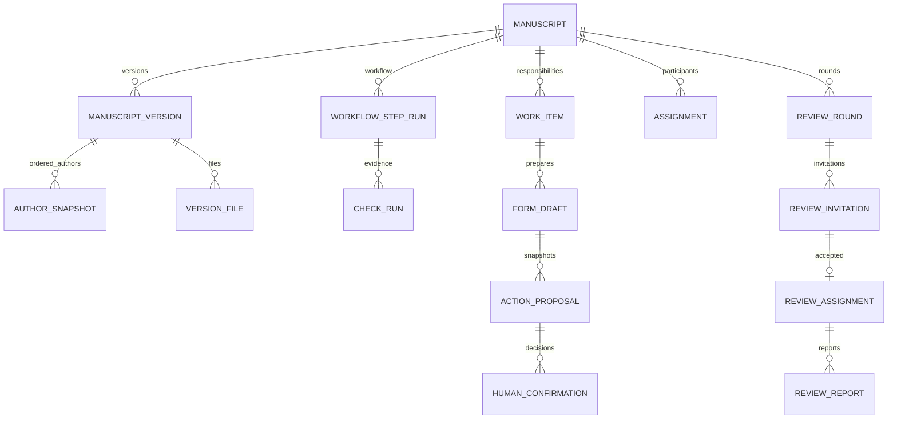

# 稿件工作流、角色待办与 AI 辅助填报规划

日期：2026-11-02。状态：后续实施规格，尚未实现；不改变当前数据库、接口权限或浏览器行为。依据用户本轮需求制定，覆盖 DESIGN.md 中“桌面默认关闭右栏”的未来布局选择。已运行原型仍以 specs/001、002 为准。

## 1. 产品主线

每篇稿件始终能回答：现在在哪一步、谁负责、还缺什么、何时到期、下一次必须由谁确认。三栏共用后端工作流事实，不由 LLM 根据聊天猜测状态。

| 区域 | 首要问题 | 内容与交互 |
| --- | --- | --- |
| 左：我的工作 | 今天需要我做什么？ | 当前期刊/角色；待我确认、逾期、今日到期、其他可处理任务；等待他人单列；会话历史降为次级入口 |
| 中：对话协作 | 怎样把这件事做好？ | 接收散乱信息、解释缺项、准备草稿、检查证据、生成待审核材料；选中待办时带入其授权上下文 |
| 右：稿件进度 | 稿件走到哪里了？ | 授权范围内的稿件状态列表；选中项突出当前步骤、负责人、等待原因、下一关口和时间线；支持切换稿件 |

桌面有选中稿件时默认三栏，不必主动打开详情才看到状态。无选中稿件时右栏列可见稿件，不捏造数据。点击左侧任务或右侧稿件，三个区域保持同一稿件上下文；中途切换先保留草稿，不自动把上一稿件的输入发给新稿件。宽度不足时采用待办/对话/稿件切换与抽屉，保持选中上下文，而非挤成三条窄列。

独立审核页是完整任务页面，具有专用 URL、可恢复草稿和返回原工作区入口。长表单不塞进聊天，不用聊天中的一句“确认”替代审核。审核页显示本次操作的目标、证据、内容差异、必填缺项和最终动作。

## 2. 稿件的“标签”分层

最显著的标签是确定性的当前步骤。其余信息辅助理解，不能改标签就推进流程。

| 维度 | 示例 | 数据权威 |
| --- | --- | --- |
| 生命周期阶段 phase | 投稿准备、初审、外审、修回、编辑决定、出版制作、已结束 | 后端工作流 |
| 当前步骤 current_step | 主编范围初筛、责任编辑质量评估、寻找审稿人 | 当前主步骤实例 |
| 步骤运行状态 | 可处理、等待负责人确认、等待作者补充、执行失败 | 步骤与阻塞任务 |
| 检查结果 | 文件齐全、查重报告待复核、匿名化待确认 | 版本绑定的检查证据与人工结论 |
| 我的任务状态 | 待领取、待处理、处理中、待确认、完成、取消 | 分派到当前用户的任务 |
| 内容分类 | 研究论文、综述、学科、关键词、专刊 | 受控分类/作者元数据；AI 可提议 |
| 优先级与期限 | 逾期、今日到期、人工加急 | due_at、规则与授权人工覆盖 |

例：主标签“寻找审稿人”；辅助事实“目标2份有效评审，已邀请3人，1人接受，0份完成”；下一动作“王编辑审核下一位候选人”。邀请数、接受数和已完成评审数分开计数。上述数字为说明结构的示例，不得作为产品默认假数据。

“已投稿”须来自作者确认的正式提交。“查重完成”仅说明任务产生报告，不代表通过；相似度不能自动等同抄袭或直接触发拒稿。“初筛”须区分编辑部材料检查、主编范围判断和责任编辑质量评估。

## 3. 默认初审流程与关口

这是用户描述对应的首个期刊流程模板，非所有期刊通用规则。先使用版本化后端代码与类型化策略配置，不建设任意可执行的低代码流程 DSL。新建稿件固定流程/表单策略版本，政策变更不默默影响在途稿件。

| 步骤 key | 界面主状态 | 负责人与放行证据 |
| --- | --- | --- |
| author_preparation | 作者整理资料 | 作者；AI整理/表单补充后，由投稿负责人独立审核并提交 |
| intake_precheck | 编辑部预审 | 指定编辑部人员（首期授权编辑承担）；审核版本、作者信息及必需声明 |
| similarity_check | 查重待复核 | 系统可运行授权检测；负责人员审核报告、来源和异常并确认，不由模型裁决 |
| technical_screen | 材料与规范筛选 | 指定编辑；确认文件、匿名化和期刊规范；退回时列明修改项目 |
| chief_scope_screen | 主编范围初筛 | 主编或有明确分派权限的代理；确认是否适合期刊范围 |
| handling_editor_assignment | 待分派责任编辑 | 主编；审核并确认责任编辑选择，生成责任分派 |
| editor_quality_screen | 责任编辑质量评估 | 已分派责任编辑；确认进入外审的建议/授权动作，正式拒稿另走决定关口 |
| reviewer_selection | 寻找审稿人 | 责任编辑；审核候选人、冲突声明、轮次/文件/评审表及期限，准备邀请草稿 |
| invitation_response | 等待审稿邀请回复 | 审稿人逐人确认接受/拒绝及利益冲突；编辑跟进，未达到目标可继续找人 |
| peer_review | 外审进行中 | 每位已接受的审稿人审核自己的评审报告并提交；编辑处理缺额、延期 |
| editor_recommendation | 编辑汇总意见 | 责任编辑；审核汇总、作者可见意见与建议，不把AI建议当决定 |
| chief_decision | 待主编决定 | 具备决定权限且无冲突的负责人；审核决定快照后确认 |
| author_revision | 等待作者修回 | 作者；提交新版本、逐点回复并审核确认，保留上一轮完整记录 |

后续制作/校样/正式发布另开规格，仍保留各负责人人类关口。退稿、录用、撤稿、公开出版不能通过普通步骤跳转调用。编辑质量评估可提出退稿建议，必须进入有权决定人的审核任务；不静默终结。

初审补充材料：进入带 return_to_step 的补充任务，保留原步骤与检查记录，补齐后重新审核受影响项目；不把作者修改后的文件视为旧报告已覆盖。正式修回：新 manuscript_version，可生成新 review_round；不覆盖或清空旧轮次。跳过检查必须由策略允许且有权负责人记录理由和确认，默认不允许。

寻找审稿人和已接受者开展评审可以并行。一个稿件保留一个主步骤用于展示，其下允许多个步骤/任务并行；右栏补充“已有1份评审进行中，仍需补足审稿人”等事实。主步骤由明确的轮次策略决定：接受人数不足目标时主状态为寻找/等待回复，足额且未满足有效报告数时为外审进行中，满足后进入编辑汇总；不得用任意一个邀请行的状态覆盖整篇稿件。目标数、例外授权、何时关闭轮次均有策略快照。

## 4. 数据模型与关系

保留现有 manuscripts.id 作为一次向期刊投稿的稳定业务 ID；首期不引入跨期刊共享“全球文章库”。未来转投新建投稿并以来源关系关联，不能覆盖原期刊历史。工作流、版本和审稿都归属于这个投稿 ID。

下列为目标逻辑模型。按第10节分批建表，不一次创建全部空表。字段名在实施迁移中定稿，结构化枚举在应用/DB双重约束；JSONB仅承载版本化内容和证据，不能代替权限/状态/关联。

| 实体 | 关键字段及约束 | 用途 |
| --- | --- | --- |
| manuscripts（扩展） | id、journal_id、submission_number、created_by、current_version_id、workflow_policy_version、phase、current_step_run_id、revision_counter、submitted_at、updated_at；journal+number唯一 | 当前业务投影；revision_counter用于并发冲突；未分派编辑时不应强制 editor_id |
| manuscript_versions | id、manuscript_id、version_no、schema_version、title、abstract、article_type_id、language、metadata_jsonb、content_digest、frozen_at、created_by；manuscript+version_no唯一 | 提交/修回后冻结，补交新版本；标题等常查字段关系化 |
| author_snapshots | version_id、ordinal、name、email、ORCID（可空）、affiliations、corresponding、contribution、linked_user_id（可空）；version+ordinal唯一 | 作者顺序与机构历史不可因个人资料改动漂移；通讯作者≠唯一有系统权限者 |
| file_objects / version_files | storage_key、sha256、size、media_type、scan_status；version_id、purpose、visibility；禁止覆盖同一内容对象 | 原稿、匿名稿、图表、补充材料、回复信；内容引用而非把二进制放JSON或只存路径 |
| assignments | manuscript_id、user_id、role/capability、stage_scope、starts_at、ends_at、assigned_by、reason | 责任编辑、主编、作者代理等有效期权限，支持重分派历史；作者身份关联与登录访问授权分别处理 |
| workflow_step_runs | manuscript_id、step_key、cycle_no、state、policy_version、responsible_assignment_id、input_version_id、entered_at、completed_at、outcome | 每次执行/退回生成实例，旧实例不可被重置掩盖；同稿同step+cycle唯一 |
| work_items（替代扩展EditorialTask） | manuscript_id、step_run_id、kind、status、assignee_id或pool_key、due_at、priority_override、override_reason、blocking、completed_at、confirmation_id | 左栏待办；有截止时间与可执行动作；池任务领取需原子竞争，确认前须落实个人负责人 |
| check_runs | step_run_id、version_id、file_digest、check_type、provider/run_ref、status、report_ref、result_jsonb、human_outcome、confirmation_id | 查重、完整性和匿名化证据；报告重跑另建记录；外部发送稿件需独立授权 |
| form_schemas / form_drafts | schema_key/version、policy_version、field definitions；draft_id、work_item_id、base_revision、data_jsonb、field_sources_jsonb、draft_revision | 结构由后端定义，AI只填白名单字段；字段来源含会话/文件位置、候选置信度、待确认状态，不等于已验证 |
| action_proposals | work_item_id、action_type、actor_scope、schema_version、policy_version、base_revision、payload_snapshot、evidence_digests、digest、status、expires_at | 送审核的不可变候选动作；包含目标稿件、轮次、文件和预计流程变更 |
| human_confirmations | proposal_id、responsible_user_id、outcome、reason、digest、confirmed_at | 不可变逐次确认/退回；依赖修改后原确认不可用于新内容，不删除旧证据 |
| review_rounds（后续） | manuscript_id、round_no、version_id、review_type、required_acceptances/reports、policy_snapshot、status | 固定审稿文件/版本、匿名规则、目标数，支持多轮 |
| review_invitations / assignments / reports（后续） | round_id、reviewer/candidate、response_due_at、review_due_at、response/status、conflict_declaration；report_version、author_visible_fields、private_fields、confirmation_id | 候选、邀请、接受和提交报告是不同事实；邀请/报告修改不能覆写历史 |
| editorial_decisions（后续） | manuscript_id、round_id、decision_type、rationale_snapshot、confirmation_id、decider_id、decided_at | 建议与正式决定分开；作者可见内容有审核版；决定≠已发送通知 |
| taxonomy_terms / manuscript_terms（按需） | journal_id、kind、code、label、term_id、manuscript_id、source、confirmed_by | 学科/栏目/专刊与主题标签；不控制状态与权限 |

现有 conversation/message 通过明确稿件上下文关联 work_item、proposal；一段对话可讨论多个稿件，任何动作都要求显式目标，不能只依赖“最近一次提到”的标题。审稿人可见聊天上下文同样经过匿名化过滤。

### 数据完整性与查询

- 业务实体都校验 journal/manuscript 归属。复合外键/唯一约束防止跨稿件挂载版本、步骤、轮次和确认；不能仅靠 UUID 难猜。
- 当前版本和主步骤必须属于同一稿件，事务保证指针与阶段一致。已提交版本/确认快照不可原地改写；重分派终止旧 assignment 并建新记录。
- 轮次和步骤循环号参与唯一约束，移除现有 `(manuscript_id, kind)` 对所有历史任务仅允许一条的限制，改为防止同执行实例重复创建同类任务。
- 索引优先覆盖 `(journal_id, phase, updated_at)`、`(journal_id, assignee_id, status, due_at)`、`(manuscript_id, cycle_no/round_no)`；所有列表有上限与cursor。JSONB索引以真实查询证据决定，避免全面建索引。
- PostgreSQL保存工作流当前投影和追加历史事件，同一事务写入；先不做全量 event sourcing。audit_events继续追加保护，不能只保留最终status。
- 时间均为UTC，due_at为精确时刻，界面按用户时区计算“今天”，无期限与逾期明确区分。待办数量和稿件列表共享权限过滤，不能用总数泄漏隐藏记录。
- 文件上传先隔离扫描，完成后才能成为已提交版本的一部分；未扫描/缺失文件阻止确认。外部查重/模型上传稿件需要明确的数据出域授权，当前默认不接真实保密稿件。

## 5. AI整理 → 表单补充 → 独立审核 → 确认生效

1. 用户将文字或授权文件放入对话。AI提取候选信息：标题、摘要、作者顺序/机构、通讯信息、关键词、文件类型、声明等；保留原始来源与不确定项。冲突值并列呈现，不擅自选一个。
2. 后端按期刊+文章类型+当前步骤的版本化schema校验，给出“已找到、缺失、冲突、需要负责人声明”的清单。必填规则来自schema；AI不能决定哪些字段可省略。
3. 只生成缺项/冲突的针对性表单，也允许用户直接更正已提取内容；较长表单分组保存和恢复。最终审核仍展示完整即将提交内容，不能只看新增字段。
4. 作者信息可预填；伦理批准、利益冲突、原创性、版权/数据可用性等声明不得默认勾选或由模型杜撰。具体必填/条件字段由期刊策略确定，适用性不由AI臆断。
5. AI准备 action_proposal，生成独立审核页链接；负责人可以编辑/退回/确认。编辑产生新proposal快照，旧链接显示已过期；缺项、冲突或未准备好的附件阻止提交。
6. 负责人在审核页明确确认。服务端重新验证身份、分派、利益冲突、schema、证据和base_revision，然后在一笔事务内记录确认、执行动作、完成任务/转换步骤、创建下一待办、写审计和幂等回执。
7. 失去分派、稿件/报告/表单/附件被修改、政策迁移或并发推进后，旧proposal返回409/失效并要求重新审核。刷新/重试同确认请求不得重复提交。

每一个业务关口均有负责人确认记录，包括初审检查的放行。检测任务运行/文件解析/草稿保存可以自动完成，它们不会自动放行业务关口。截止时间、模型高置信度或对话中的“看起来可以”均不能产生human_confirmation。Agent令牌不能调用最终确认动作；禁止代理冒充用户确认。服务端记录人类交互凭证与操作会话，但不声称能够从客户端标记绝对证明操作者是生物学意义的人类。

多人负责时使用显式 required_confirmers/confirmation_slots，全部当前责任人满足才能通过，不能用“任意编辑批准”代替；首批每项一个明确负责人。重分派或代理必须记录授权和理由，新负责人重新确认，旧负责人记录仍保留。此处的“每个负责人”不自动扩展为要求所有共同作者逐人签署：共同作者确认规则由期刊策略另行配置，不能替通讯作者勾选其同意。

## 6. 角色权限与待办优先级

| 角色 | 左栏默认任务 | 右栏可见范围 / 限制 |
| --- | --- | --- |
| 作者 | 投稿信息待补充、待本人审核提交、编辑退回、修回/校样待确认 | 自己有明确访问授权的稿件；只见对作者发布的状态与意见，不见审稿人身份/编辑私密评论 |
| 编辑部/责任编辑 | 预审/查重复核、质量评估、选审稿人、邀请草稿待审核、缺额/逾期跟进、汇总建议 | 其分派与阶段内稿件；角色不代表可读取全期刊，双重身份触发冲突检查 |
| 主编 | 范围初筛、待分派、例外/冲突处理、待正式决定 | 被授予的期刊监督/决定范围，作者兼主编不能审批自己稿件 |
| 审稿人 | 邀请待回复、利益冲突声明、待评审、评审报告待审核提交 | 只见邀请策略允许的摘要、接受后对应轮次授权材料与自己的报告；不见他人私密评审和未经允许作者信息 |

资格=期刊成员权限+有效分派/所有权+阶段+冲突规则，后端逐次判断。匿名化在查询/序列化和文件层完成，不能只靠前端隐藏姓名。AI得到的上下文不得比该用户更多。多角色membership与分派capability分开；切换视角不增加用户实际权限，个人待办可汇总其合法角色但必须标明任务职责。

排序默认规则：需我立即确认且阻塞流程 / 逾期 / 今日到期 / 已领取可推进 / 其他未来任务；同级按due_at、创建时间、稳定ID。等待他人的项目独立呈现，不与可执行待办混排。不制造每日假任务；没有任务时明确为空。授权人员可以加急/调整期限，须有理由、审计、可见来源；AI仅可建议排序，不能偷偷提高稿件业务优先级。最终排序细则由可配置确定性规则控制，显示实际到期时间和排序原因。

## 7. 计划接口与并发边界

以下接口仅为拟定契约，当前不能调用；新增到OpenAPI前需实现验收：

- `GET /api/me/work-items?bucket=actionable|waiting&cursor=...`：权限过滤后的待办、原因、负责人、稿件步骤；服务端计数。
- `GET /api/manuscripts?phase=...&cursor=...`：角色可见稿件与当前状态摘要；支持右栏，不让LLM生成列表。
- `GET /api/manuscripts/{id}/progress`：主步骤、授权时间线、阻塞项、负责人/匿名显示、允许的下一动作、revision。
- `POST /api/intake-drafts`：作者/授权代理创建真实准备稿；不会调用当前仅编辑可用的合成稿工具来绕过权限。
- `PATCH /api/form-drafts/{id}`：带draft_revision，保存候选值/来源，不生效为正式提交。
- `POST /api/work-items/{id}/proposals`：白名单动作与目标revision；后端生成不可变快照/digest。
- `GET /api/proposals/{id}/review`：完整授权审核材料与失效状态，对应独立审核页。
- `POST /api/proposals/{id}/confirmations`：仅当前负责人交互会话、CSRF、digest、expected_revision、request_id；Agent不暴露此工具。

事务：锁定稿件/任务 → 校验版本/责任人 → 校验所需确认 → 写确认及业务变化 → 关闭/生成待办 → 审计/回执 → commit。锁顺序固定；409不得静默覆盖；重试返回原回执。审核页打开不构成锁定，不在用户读长表单期间持有数据库锁。技术检测使用可重试任务记录，完成时必须核对输入版本，不将旧结果附到新稿。

## 8. 安全及邮件边界

全程延续SECURITY.md。对话输入、文件内容、AI提取和外部查重报告均不可信。只读JSON表单schema，不执行模型生成的JS/HTML/验证代码。审计记录动作及快照引用，不把整份保密材料反复复制到通用日志；原始材料有受控权限和保留策略。

邀请候选人确认、业务决定确认、邮件内容批准是不同关口。批准一个候选人或作出决定不等于批准邮件外发；邮件仍逐封绑定收件人、正文、附件快照，修改即失效。EMAIL_SEND_ENABLED=false；本规格不启用任何真实邀请发送、外部查重上传、生产部署或真实模型稿件处理。

## 9. 现有数据库的迁移缺口

当前 `Manuscript.status` 只有draft/submitted/screening；`editor_id`必须非空；`author_id`仅一人；`EditorialTask`没有期限/轮次且按稿件+kind唯一；`Membership`一人同期刊只有一个role。不能用添加几个文本标签掩盖这些结构限制。

迁移采用expand → backfill → dual-read比较 → 切换写入/查询 → 后续contract。先备份并在合成副本演练，旧接口兼容期有明确映射与审计。保留稿件ID、消息、会话、邮件安全和回执幂等。旧screening记录映射为`legacy_screening`步骤，不伪造其已完成预审/查重/主编批准；原编辑任务转换为相应历史/当前待办。旧author_id导入作者与授权关系，但不凭姓名/邮箱推定其他共同作者系统权限。新投稿逐步允许编辑尚未分派；旧editor_id在兼容期作为只读投影。

迁移不追溯编造缺少的人工确认；旧记录显式标注legacy provenance。待历史数据、事务并发和权限兼容测试通过后才删除旧字段约束。未来的schema设计审核不等于已经执行迁移。

## 10. 实施切片和验收计划

| 顺序 | 可运行交付 | 核心验收（全部待实施） |
| --- | --- | --- |
| A 数据与待办基础 | 版本/步骤实例/责任分派/可重复任务；真实三栏和角色工作清单 | 旧数据不丢；旧screening不伪造经过；相同稿件三栏一致；角色/分派/匿名字段隔离；逾期/时区排序 |
| B 作者辅助投稿 | 收集信息→候选字段→缺项/冲突表单→独立审核页→负责人确认→投稿 | 草稿可恢复；来源可追溯；声明不默认勾选；无确认不得提交；重复确认只提交一次；表单/附件修改旧审核失效 |
| C 分段初审 | 预审→查重报告复核→材料筛选→主编范围初筛→分派→编辑质量评估 | 每关负责人确认；无权限不可代办；并发提交409；退回补充/新版本使旧证据失效；未接检测器时明确未检测 |
| D 选人与外审 | 候选/冲突检查、邀请草稿审批、轮次/分派/报告审核 | 寻人和外审并行准确；多次邀请不重复计有效报告；审稿人只见所分派轮次；邮件禁发不变 |
| E 决定与修回 | 建议与决定分离、逐轮回复、新版本与再次审查 | 无人工决定不录用/拒稿；历史轮次可追溯；作者意见发布与私密意见隔离 |

每片依次Research→Plan→Implement→Test→Review→Fix，Pytest覆盖DB约束、权限/版本/事务，Playwright覆盖实际角色与刷新恢复，运行scripts/verify.sh并记录新证据。下一次实施优先A+B贯通作者投稿的一条真实链，再逐关扩展C，不能一次创建所有表或用静态三栏宣称完成。

## 11. 参考与取舍

本流程顺序、人类逐关审核和三栏职责来自用户要求；下列资料仅支持拆分阶段、分派、审稿轮次和可见性，并不证明本规格已实现。2026-11-02实际读取：

- [OJS 3.5 投稿阶段官方文档](https://raw.githubusercontent.com/pkp/pkp-docs/main/learning-ojs/editorial-workflow/en/submission.md)：分派处理人与建议/最终决定权限可分开。我们保留确定性关口，未复制其自动邮件行为。
- [OJS 3.5 审稿阶段官方文档](https://github.com/pkp/pkp-docs/blob/main/learning-ojs/editorial-workflow/en/review.md)：文件、邀请、轮次、修回及决定需要分别跟踪。
- [Janeway 官方审稿指南](https://janeway.systems/pages/support/guides/editor-guide-to-review.html)：审稿文件/轮次、邀请响应和评审、表单/期限是独立配置。我们进一步要求负责人审核与邮件逐封审批，不采用其可直接发通知的交互。
