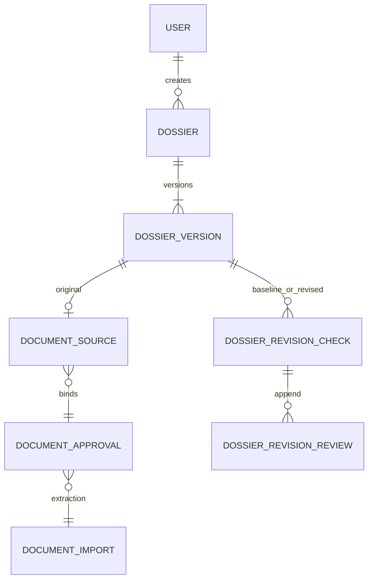

# spec027 内部资料核对执行合同

依据用户2026-11-05提供的执行建议，落实资料核对与内部修回核对。它不授予正式投稿、邮件、出版决定、生产部署或PR合并权限。完整阶段计划见027-single-journal-pilot-readiness.md，实际执行结果见PROGRESS.md。

## 复用和新增

复用Dossier、DossierVersion、DocumentImport/Approval/Source、私有CAS、原文定位、统一Action Gateway、权限重验及已有只读修回比较器。

原PDF/DOCX完整确认保持原路径、指纹和DossierCheck语义。新增save-material动作仍由负责人核对原件/文字/当前表单后保存不可变版本和原件绑定，但不创建完整资料DossierCheck；作者、摘要、关键词等缺项继续显示，不阻止无关的正文问答。已有文件的再次导入表单默认保留已保存字段，明确选择后才能改用本次识别候选；不按作者位置自动合并。

资料导出是精确版本的私人只读JSON，包括元数据、缺项、来源和核对状态；不对ORCID作身份认证。不含私人问答、模型凭据或存储路径。

内部修回材料包绑定同一资料的两个实际版本。原稿早于修订稿，生成时修订稿必须是当前版；不创建Manuscript、正式RevisionRequest或EditorialDecision。现阶段意见与作者回复使用明确来源的粘贴文字，PDF/DOCX原稿/修订稿沿用导入路径。意见由编辑预拆为1—8条要求，每条保留原意见上下文；不是已经实现自动可靠拆解复合要求，也不宣称已导入完整原生回复文件。

四项完整度分别保存原稿、修订稿、意见集合、作者回复。它们是实际操作者对所提供材料范围的说明，不是模型签署或科研真实性认证。部分集合只能说明已提供条目的情况，未定位不等于全文没有修改。

## 数据合同

**DossierRevisionCheck / publishing_dossier_revision_checks**

12字段：id、dossier_id、journal_id、base_version_id、revised_version_id、revision、materials_json、report_json、digest、created_by、session_hash、created_at。

两个复合外键把原/修订版本绑定相同资料和期刊；revision为资料修订序号，不是评审轮次。materials_json固定预拆要求、原意见上下文、粘贴回复、四项完整度及来源说明。report_json保存已有比较器的逐项结果、实际引用、覆盖与供应商遥测。digest绑定两者；来源指纹另绑定实际版本、原件和提取字节。该小型记录属于项目治理对象，没有声称上游提供同名表。

**DossierRevisionReview / publishing_dossier_revision_reviews**

15字段：id、check_id、dossier_id、journal_id、point_id、check_digest、response_verdict、implementation_verdict、editor_verdict、reason、review_no、reviewed_by、session_hash、created_at。

回应判断：已回应、未回应、待核对。正文落实：相关修改、部分落实、未修改、尚未定位、待核对。编辑处理：足以处理、继续跟进、需要判断。三者独立保存，允许“有解释且未修改，编辑认为无需进一步处理”。必须有本人核对理由及显式确认，不产生录用、拒稿或修回业务决定。

每条要求追加人工记录，check_id/point_id/review_no唯一。写入时锁资料，要求expected_review_id对应当前头，避免后到判断覆盖先到结果。旧包仍可追加判断，但明确为历史材料；不自动迁移到新版本。

迁移28a7c1e09462从f59230d88725增量新增两表，不修改旧表/回执指纹。SQL复合外键、形状/责任人/会话/版本/序号守卫及禁止历史更新、删除、清空共同保护；已有历史时拒绝降级。源码绑定与实际执行证明分开记录。

## 接口和写入流程

POST /api/dossiers/{id}/revision-checks：当前本人编辑/主编、CSRF、资料与版本范围、真实CAS与原件、材料范围和疑似凭据检查；共享60秒模型期限，原授权/版本在推理和锁等待后重验；最后同事务写不可变包、审计和回执。失败没有部分成功包。相同UUID只重放同一请求，不重跑工具。

GET同路径列表有界分页；GET /{check_id}按当前授权读取历史包；GET /{check_id}/export导出完整包、实际源正文和最新人工判断，no-store、附件下载。导出后的外部副本不能由平台撤回。

POST /{check_id}/points/{point_id}/reviews：绑定目标包/摘要/条目、前一判断和本人理由，按统一网关追加；GET同路径只读分页历史。模型没有人判写入、资料确认、邮件发送或出版决定工具。

## 权限矩阵

| 操作者 | 内部资料及核对包 | 写入/人工判断 |
| --- | --- | --- |
| 本资料创建者且当前为编辑/主编 | 读取本人版本、原件、核对与导出 | 当前材料生成；历史包可追加本人判断 |
| 同刊其他编辑/主编 | 无默认访问 | 无 |
| 作者、审稿人、制作人员 | 无私人资料访问 | 无 |
| 模型 | 后端发放的当前授权材料 | 只提出比较结果；无负责人确认工具 |

撤权、注销、换期刊或角色后，旧链接、回执与后台等待均重新鉴权。导出在服务器完成前和浏览器下载前复核身份。正式业务原权限矩阵不变。

## 从现有数据整理的关系

账号资料与各版本作者快照分离；内部资料不自动进入正式投稿关系。一个版本可被多个核对包引用，重新提取会产生新导入/版本，不覆盖旧解析；回答仍指向原来的版本与原件。

## 研究与取舍

2026-11-05重新阅读[OJS官方编辑流程](https://github.com/pkp/pkp-docs/blob/main/learning-ojs/editorial-workflow/en/README.md)、[Janeway作者快照](https://janeway.readthedocs.io/en/latest/dev/pii.html)与[评审指南](https://janeway.systems/pages/support/guides/editor-guide-to-review.html)。继续采用账号与历史署名分离、文件/轮次明确关联、作者可见反馈与私密意见分离的经验；不把内部辅助核对冒充正式修回请求。没有复制上游实现或采用其自动通知行为。

本次新增两表只保存内部核对的多版本依赖和追加人判；不为统一名称重构已有领域、不新增人物主数据系统、工作流设计器、微服务或向量数据库。不能将模型状态或人判多数提升为出版决定。
